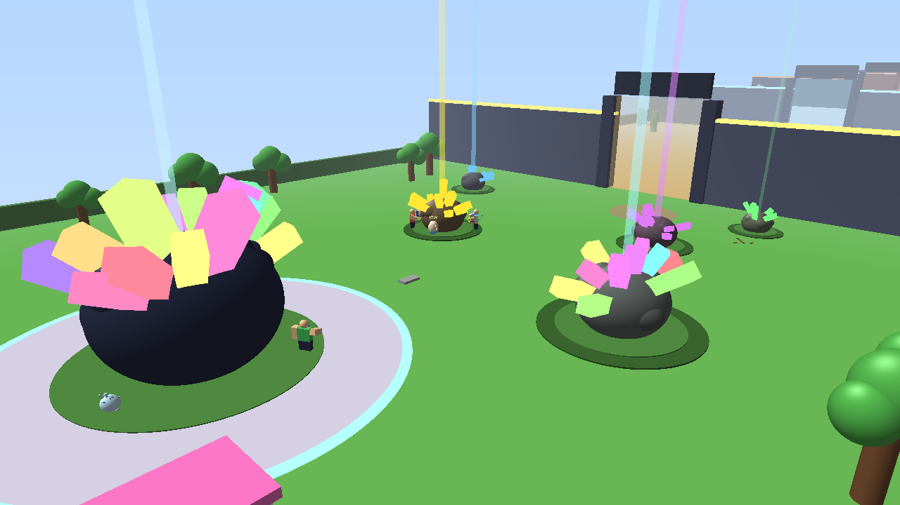
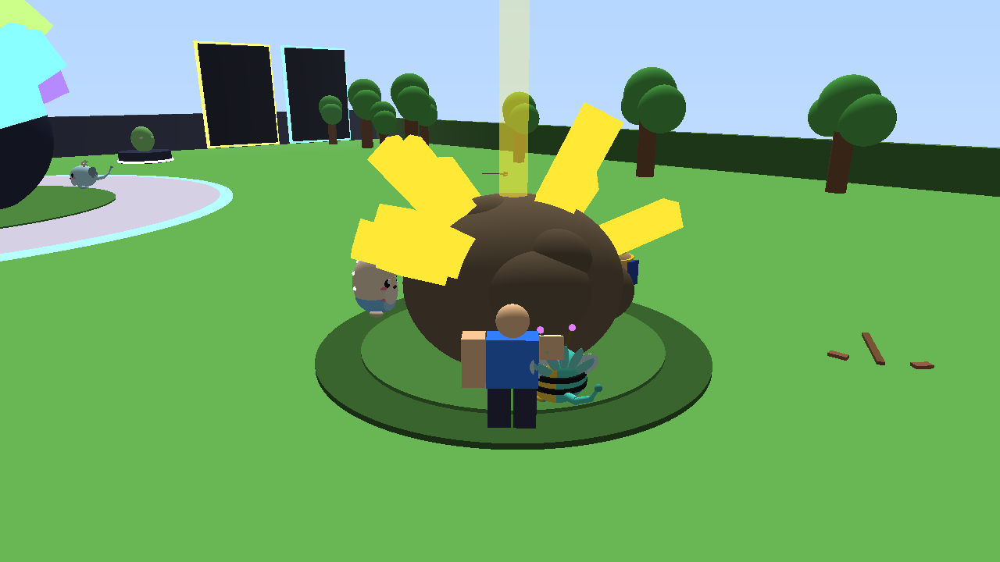
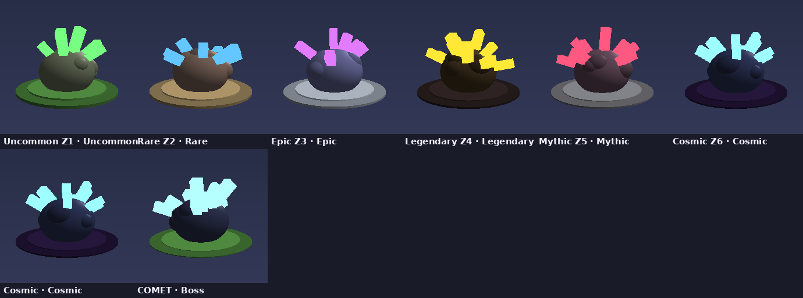
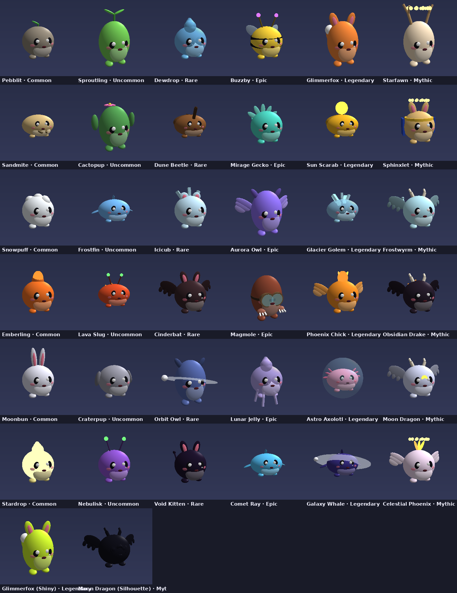

# ☄️ Meteor Rush — juego original de Roblox

**Caen meteoritos del cielo en tiempo real y todo el servidor corre a por ellos.**
Pícalos con tus amigos (o contra ellos), reparte el botín según el daño, abre huevos de
criaturas cósmicas que pican contigo, desbloquea 6 zonas hasta la Nebulosa y únete al servidor
entero contra el **Cometa Gigante**.

Todo está hecho por código (mapa, modelos 3D, interfaz): no necesitas assets externos.



| Picando con tus criaturas | Meteoritos por rareza |
|---|---|
|  |  |



> Imágenes renderizadas desde la geometría real que genera el juego (sin la interfaz).

---

## 🎮 El bucle que engancha

1. ⚠️ **Aviso**: aparece un círculo en el suelo con cuenta atrás y un **haz de luz del color de la rareza** (se ve desde lejos). El **radar** del HUD te señala la dirección.
2. ☄️ **Impacto**: la bola de fuego cae, tiembla la pantalla y la **onda expansiva lanza por los aires** a quien esté debajo.
3. ⛏️ **A picar**: haz clic cerca del meteorito. Tus **criaturas** saltan alrededor y pican contigo. La barra de vida muestra quién va ganando.
4. 💰 **Botín**: se reparte según el daño. El **MVP** gana +25% y puede llevarse un **huevo de meteorito** (Rare+). Romperlo en equipo da +15% por jugador.
5. 🥚 **Huevos**: gasta Stardust en huevos → criaturas (con **shiny 1/40**) que suben tu daño.
6. 🗺️ **Zonas**: 🌿 Pradera → 🏜️ Desierto → ❄️ Tundra → 🌋 Magma → 🌙 Luna (**gravedad baja**) → 🌌 Nebulosa.
7. 🌟 **Supernova** (rebirth): reinicias Stardust/picos/zonas pero **conservas las criaturas** y ganas bonus permanentes.
8. ☄️ **Cometa Gigante** cada 20 min: cae en la plaza, su vida se ajusta al servidor y **todos** los que participan ganan premio (los 3 primeros, criaturas).

## ✅ Qué incluye

| Sistema | Detalles |
|---|---|
| Meteoritos | 7 rarezas (Common → **Cosmic** con cristales arcoíris), caída animada, impacto con onda expansiva, vida compartida, top de daño en el cartel |
| Picar | 10 picos (Rusty → Nebula + Galaxy Hammer por Robux), críticos, Auto Mine (pase) |
| Criaturas | **36 criaturas originales** en 6 huevos, shiny, inventario, equipar las mejores, auto-borrado, te siguen y pican contigo |
| Zonas | 6 zonas con su ambiente (luz, niebla), puertas que se abren solo para ti, teletransporte, anti-trampas |
| Progresión | Supernovas, mejoras (velocidad, crítico, suerte de huevos), Index (normal + shiny) |
| Retención | **Misiones diarias** (3 + premio), regalos por tiempo jugado (12), diario con racha de 7, códigos, pistas de tutorial |
| Eventos | 🌠 Lluvia de meteoritos, 🌕 Luna de sangre (cielo rojo, suerte x3), ✨ Hora dorada, ☄️ Cometa Gigante, suerte de admin |
| Social | Botín compartido + MVP, anuncios de rarezas, bonus por amigos, tablones globales, etiqueta VIP/Supernova |
| Monetización | 8 Game Passes + 8 Developer Products pensados para este juego |
| Datos | DataStore con **bloqueo de sesión** (sin duplicados), autoguardado, compras idempotentes |

---

## 🚀 Abrirlo en Roblox Studio

1. Abre **`MeteorRush.rbxlx`** con Roblox Studio y pulsa **Play** ▶️ (el mapa se genera al arrancar).
2. Para ver el multijugador: *Test → Clients and Servers → 2-3 jugadores → Start*.

En Studio la tienda **simula las compras** si aún no pusiste IDs, así puedes probar todo.

**Con Rojo** (si vas a programar): `rojo serve` y conecta el plugin; para regenerar el archivo:
`rojo build default.project.json -o MeteorRush.rbxlx`.

## 🌍 Publicar

1. *File → Publish to Roblox*.
2. **Game Settings → Security → Enable Studio Access to API Services** (guardado y rankings).
3. Max Players recomendado: **12–16** (más gente = más competencia por los meteoritos).
4. Título sugerido para búsquedas: **"Meteor Rush ☄️"** o **"Catch a Meteor ☄️"**.

## 💰 Monetización

Crea los Passes y Developer Products en el [Creator Dashboard](https://create.roblox.com/dashboard/creations) y pega los IDs en `src/shared/Products.luau`.

| Clave | Tipo | Precio sugerido | Por qué vende |
|---|---|---|---|
| `CallComet` | Product | 199 R$ | **Llama al Cometa Gigante para todo el servidor** (anuncio con tu nombre) |
| `SummonMeteor` | Product | 79 R$ | Un meteorito Legendary+ cae junto a ti, **reservado 15 s** solo para ti |
| `ServerLuck` | Product | 99 R$ | Suerte x2 para todos 15 min (presión social) |
| `SuperEgg` | Product | 299 R$ | Criatura Legendary garantizada (15% Mythic) |
| `PowerBoost` | Product | 49 R$ | x2 daño y x2 stardust 20 min |
| `Stardust*` | Product | 25 / 99 / 349 R$ | Escalan con tu mejor zona → siempre útiles |
| `DoubleStardust` | Pass | 299 R$ | x2 stardust para siempre |
| `AutoMine` | Pass | 249 R$ | Pica solo (clave en móvil) |
| `TripleHatch` | Pass | 249 R$ | Abre 3 huevos a la vez |
| `LuckyHatch` | Pass | 299 R$ | x1.5 suerte en huevos |
| `VIP` | Pass | 199 R$ | +20% stardust, +10% daño, etiqueta |
| `ExtraSlots` | Pass | 199 R$ | +2 criaturas equipadas |
| `RocketBoots` | Pass | 149 R$ | +velocidad y salto: llegas antes a los meteoritos |
| `GalaxyHammer` | Pass | 399 R$ | El arma más fuerte |

## ⚙️ Personalizar

| Archivo | Qué cambias |
|---|---|
| `src/shared/Config.luau` | Ritmo de meteoritos, cometa, eventos, recompensas, **códigos**, sonidos, admins |
| `src/shared/Zones.luau` | Zonas: coste, vida y botín de los meteoritos, colores, ambiente |
| `src/shared/Rarities.luau` | Probabilidad, vida y botín de cada rareza |
| `src/shared/Critters.luau` | Criaturas y huevos (poder, rareza, aspecto) |
| `src/shared/Gear.luau` | Picos y mejoras |
| `src/shared/Quests.luau` | Misiones diarias |
| `src/shared/Products.luau` | IDs de Robux |
| `src/shared/Models.luau` | Aspecto 3D de criaturas, huevos y meteoritos |

**Añadir una criatura** = una línea en `Critters.luau`, combinando rasgos (`PointyEars`, `BatWings`, `Halo`, `Flame`, `Horns`, `OrbitRing`…):
```lua
{ Id = "rocket_pup", Name = "Rocket Pup", Rarity = "Epic", Egg = 2, Power = 2, Color = rgb(255, 120, 80), Features = { "FloppyEars", "Flame" } },
```

## 👑 Comandos de admin (chat)

```
!stardust 1m            stardust (k, m, b, t)
!meteor cosmic [zona]   hace caer un meteorito cerca de ti
!comet                  lanza el Cometa Gigante ya
!event BloodMoon 120    MeteorShower | BloodMoon | GoldenHour
!luck 5 10              suerte x5 durante 10 min ("admin abuse")
!critter mythic shiny   te da una criatura (rareza o id)
!zones  !rebirth  !reset  !help
```

## 🗂️ Estructura

```
src/shared/   config, zonas, rarezas, criaturas, picos, misiones, economía, modelos 3D
src/server/   Main + 17 servicios (datos, mapa, zonas, meteoritos, cometa, picar, criaturas,
              misiones, tienda, supernova, recompensas, monetización, eventos, ranking, admin…)
src/client/   HUD con radar, 10 ventanas, eclosión animada, criaturas que te siguen,
              bolas de fuego, ambiente por zona, gravedad lunar, efectos
tests/        simulador de Roblox (Lune) + pruebas + renderizador de vistas previas
```

Todo es **autoritativo en el servidor** (el cliente solo pide acciones con límite de peticiones).

## 🧪 Pruebas

Probado en un **simulador de Roblox** (`tests/sim/Sim.luau`) que valida propiedades, tipos, enums,
eventos y métodos contra el API oficial, con servidor + varios clientes y tiempo virtual. Recorre:
caída e impacto de meteoritos, picar, botín compartido y MVP, picos, huevos, criaturas ayudantes,
zonas y anti-trampas, meteorito reservado, cometa, misiones, eventos, admin, supernova, regalos,
diario, códigos, compras con recibo, todas las ventanas y botones, guardado y 10 min de partida.

```bash
bash tests/run_tests.sh       # requiere Lune
bash tests/tools/preview.sh   # regenera docs/*.png (numpy + pillow)
```

> El simulador no sustituye a probar en Roblox (física, aspecto real de la UI, móvil).

## 📈 Consejos

- Programa **"Cometas" en directo** y "admin abuse" (`!luck 5 30`, `!meteor cosmic`) los fines de semana.
- Añade 1 zona o 1 huevo nuevo cada 2 semanas; códigos nuevos con cada actualización.
- Los clips de "¡cayó un COSMIC!" y del Cometa Gigante funcionan muy bien en TikTok/Shorts.
