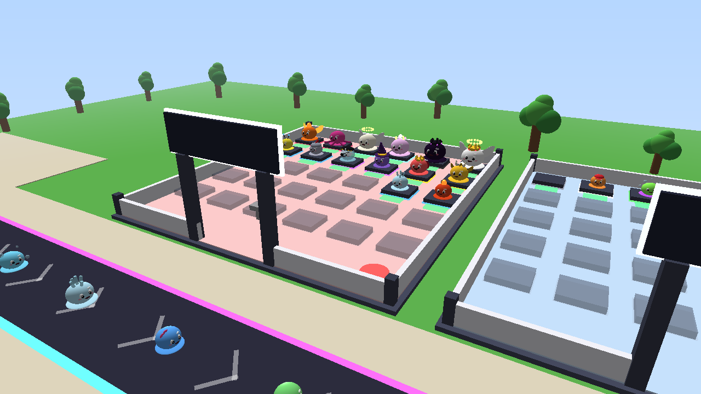
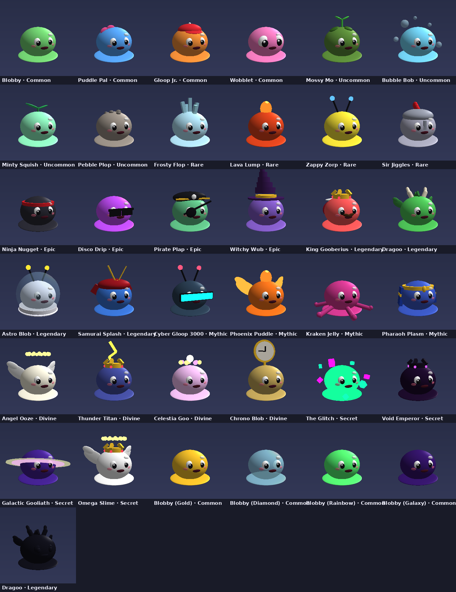
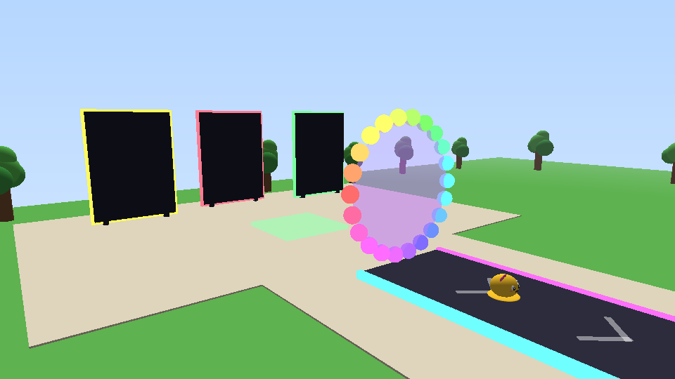

# 🧪 Slime Heist — juego de Roblox estilo "Steal a…"

Juego completo de Roblox del género *steal* (como los que arrasan ahora): compras criaturas en una
pasarela, generan dinero en tu base, **robas las de otros jugadores** y proteges las tuyas con un
candado y un bate. Temática **original** (slimes), con todos los sistemas de retención y
monetización que hacen que estos juegos enganchen y facturen.

Todo está hecho por código (mapa, modelos, interfaz): no necesitas assets externos.



| Los 32 slimes + mutaciones | Portal y zona de inicio |
|---|---|
|  |  |

> Las imágenes son renders de la geometría real que genera el juego (sin textos de la UI).

---

## 🎮 Cómo se juega (el bucle que engancha)

1. **Compra** slimes en la pasarela central (salen del portal cada 2,4 s; pulsa **E**).
2. El slime **camina hasta tu base** y genera **$/segundo** en su pedestal.
3. **Pisa el pad verde** para cobrar (o compra *Auto Collect*).
4. **Roba**: entra en otra base, mantén **E** sobre un slime y corre a tu base con él encima de la cabeza.
5. **Defiende**: pisa tu **botón rojo** para bloquear la base (barrera), o **golpea al ladrón con el bate** para que lo suelte.
6. **Rebirth**: reinicia a cambio de +50% ingresos, +2 slots y +5 s de candado permanentes.

## ✅ Qué incluye

| Sistema | Detalles |
|---|---|
| 32 slimes originales | 8 rarezas (Common → **Secret**), ~35 accesorios distintos, efectos por rareza |
| Mutaciones | Gold x1.5, Diamond x2, Rainbow x4 (color animado), Galaxy x8 |
| Pasarela | Pesos por rareza, **suerte** que escala, anuncios a todo el servidor de rarezas altas |
| Robos | Llevar el slime encima, alarma para el dueño, rayo guía a tu base, anti-teletransporte, sin duplicados |
| Bates | 5 bates (madera → Galaxy por Robux), golpe con empujón que hace soltar el slime |
| Candado | Barrera por base (solo el dueño la atraviesa), duración mejorable, recarga obligatoria |
| Progresión | Rebirths, mejoras de velocidad y candado, slots desbloqueables, Index (+0,5% por descubrimiento) |
| Retención | Regalos por tiempo jugado (12), diario con racha de 7 días, códigos, ganancias offline, pistas de tutorial |
| Social | Bonus por amigos (+10% c/u), tablones globales (dinero, rebirths, robos), etiqueta VIP/rebirth |
| Eventos | Lucky Storm, Golden Hour, Slime Frenzy, Cash Party, Money Rain (monedas que caen) cada 10 min |
| Monetización | 7 Game Passes + 8 Developer Products (suerte de servidor, slimes Secret/Mythic, packs de cash escalados…) |
| Admin | `!cash`, `!spawn`, `!give`, `!event`, `!luck` ("admin abuse"), `!rebirth`, `!lock`, `!reset` |
| Datos | DataStore con **bloqueo de sesión** (evita duplicar slimes entre servidores), guardado automático, idempotencia de compras |
| UI | Estilo cartoon, escalado automático para móvil, contador de dinero animado, notificaciones y anuncios |

---

## 🚀 Abrirlo en Roblox Studio

### Opción A — rápido (sin instalar nada)
1. Abre **`SlimeHeist.rbxlx`** con Roblox Studio (doble clic o *File → Open from File*).
2. Pulsa **Play** ▶️. El mapa se genera al arrancar.

> En Studio todo funciona aunque no hayas configurado los productos: la tienda **simula las compras**
> (verás `[Studio] Simulated…`) para que puedas probar cada pase y producto.

### Opción B — desarrollo con Rojo (recomendado si vas a modificar el código)
1. Instala [Rojo](https://rojo.space) (CLI + plugin de Studio).
2. En esta carpeta: `rojo serve` y conecta desde el plugin en Studio.
3. Para regenerar el archivo de lugar: `rojo build default.project.json -o SlimeHeist.rbxlx`.

## 🌍 Publicar el juego

1. *File → Publish to Roblox*.
2. **Game Settings → Security → Enable Studio Access to API Services** (para que se guarden los datos y funcionen las clasificaciones).
3. **Game Settings → Places / Basic Info → Max Players = 8** (hay 8 bases).
4. Pon **Genre** y una buena miniatura. Título sugerido para búsquedas: **"Steal a Slime 🧪"** o **"Slime Heist 😈"**.
5. Cambia `Config.GroupId` si tienes grupo (sus miembros reciben +10%).

## 💰 Configurar la monetización (lo que hace dinero)

1. En el [Creator Dashboard](https://create.roblox.com/dashboard/creations) → tu experiencia → **Monetization**:
   - Crea los **Passes** y los **Developer Products** de la tabla.
2. Copia cada **ID** en `src/shared/Products.luau` (campo `Id`).
3. Vuelve a publicar.

| Clave | Tipo | Precio sugerido | Por qué vende |
|---|---|---|---|
| `DoubleCash` | Pass | 299 R$ | El clásico: x2 permanente |
| `VIP` | Pass | 199 R$ | +25% cash + estatus visible (etiqueta dorada) |
| `AutoCollect` | Pass | 149 R$ | Comodidad: no tener que volver a cobrar |
| `ExtraSlots` | Pass | 249 R$ | +6 slots: más ingresos y más espacio para robar |
| `SpeedBoost` | Pass | 149 R$ | Huir más rápido con lo robado |
| `LongerLock` | Pass | 99 R$ | Más seguridad para tu base |
| `GalaxyBat` | Pass | 399 R$ | El bate más fuerte (defensa) |
| `ServerLuck` | Product | 99 R$ | **Suerte x2 para TODO el servidor 15 min** (se anuncia con tu nombre → presión social) |
| `SummonSecret` | Product | 799 R$ | Un slime **Secret** camina a tu base (anuncio global) |
| `SummonMythic` | Product | 149 R$ | Un slime **Mythic** camina a tu base |
| `CashBoost` | Product | 49 R$ | x2 cash 30 min |
| `CashSmall/Medium/Large` | Product | 25/99/349 R$ | **Escalan con tus ingresos** (10 min / 1 h / 5 h) → siempre útiles |
| `InstantLock` | Product | 19 R$ | Bloquear YA aunque esté recargando (compra impulsiva cuando te roban) |

`ProcessReceipt` registra cada compra en los datos del jugador para no aplicarla dos veces.

## ⚙️ Personalizar

| Archivo | Qué cambias |
|---|---|
| `src/shared/Config.luau` | Balance general: dinero inicial, velocidad de la pasarela, candado, rebirths, eventos, **códigos**, recompensas diarias, regalos, sonidos, admins |
| `src/shared/Slimes.luau` | Añadir/editar slimes (nombre, rareza, precio, ingresos, color, accesorios) |
| `src/shared/Rarities.luau` | Pesos de aparición de cada rareza |
| `src/shared/Mutations.luau` | Probabilidad y multiplicador de mutaciones |
| `src/shared/Gear.luau` | Bates y mejoras |
| `src/shared/Products.luau` | IDs y textos de la tienda Robux |
| `src/shared/SlimeBuilder.luau` | Aspecto 3D de los slimes y accesorios (`Accessories.X`) |

**Añadir un slime** = una línea en `Slimes.luau`, p. ej.:
```lua
{ Id = "taco_slime", Name = "Taco Slime", Rarity = "Epic", Price = 50_000, Income = 1_200, Color = rgb(240, 190, 80), Accessories = { "Cap", "Sparkle" } },
```

**Sonidos**: por defecto usa sonidos que vienen con Roblox (`rbxasset://`). Para que el juego suene mejor,
cámbialos en `Config.Sounds` por `rbxassetid://ID` de la Creator Store (pestaña Audio).

## 👑 Comandos de administrador (chat)

En Studio todos son admin; en el juego publicado, el creador y los `Config.Admins`.

```
!cash 1m                 dinero (acepta k, m, b, t)
!spawn secret galaxy     slime de esa rareza/id en la pasarela (todos pueden comprarlo)
!give omega_slime gold   slime directo a tu base
!event MoneyRain 120     evento (LuckyStorm, GoldenHour, SlimeFrenzy, CashParty, MoneyRain)
!luck 5 10               suerte x5 durante 10 min  ← "admin abuse", ideal para directos/finde
!rebirth  !lock  !reset  !help
```

## 🗂️ Estructura

```
src/
  shared/   (ReplicatedStorage.Shared)   config, catálogos, economía, builder 3D, remotes
  server/   (ServerScriptService.Server) Main + 15 servicios (datos, bases, pasarela, robos, combate,
                                          tienda, rebirth, recompensas, monetización, eventos, ranking, admin…)
  client/   (StarterPlayerScripts.Client) HUD, ventanas (Shop, Store, Rebirth, Index, Gifts, Daily, Codes),
                                          animaciones locales, notificaciones, efectos
tests/      simulador de Roblox en Lune + pruebas de todas las mecánicas
```

Todo es **autoritativo en el servidor** (el cliente solo pide acciones a través de un `RemoteFunction`
con límite de peticiones), así que los exploiters no pueden darse dinero ni slimes.

## 🧪 Pruebas

El código se ha probado en un **simulador de Roblox** (`tests/sim/Sim.luau`) que valida cada
propiedad, tipo, enum, evento y método contra el API oficial de Roblox, con tiempo virtual,
servidor + varios clientes, DataStores y compras. Recorre: entrar, comprar, cobrar, candado,
robar, anti-teleport, golpear, abrir todas las ventanas y pulsar todos los botones, rebirth,
todos los eventos, regalos, diario, códigos, compras con recibo, salir/volver (guardado) y 10 min de partida.

```bash
bash tests/run_tests.sh        # requiere Lune (https://lune-org.github.io/docs)
bash tests/tools/preview.sh    # regenera las imágenes de docs/ (requiere numpy + pillow)
```

> El simulador no sustituye a jugar en Roblox de verdad (física, renderizado, móviles). Pruébalo en
> Studio con *Test → Start* con 2–3 jugadores para ver los robos en acción.

## 📈 Consejos para que crezca

- Actualiza **cada semana** con 2–4 slimes nuevos (es una línea cada uno) y un código nuevo.
- Haz **"admin abuse"** los fines de semana con `!luck 5 30` y `!spawn secret`: la gente se queda y compra *Server Luck*.
- Usa los anuncios de rarezas como gancho en TikTok/Shorts ("¡salió un SECRET!").
- Mantén los IDs de productos configurados: el *Server Luck* y los *Secret* son los que más facturan en este género.
